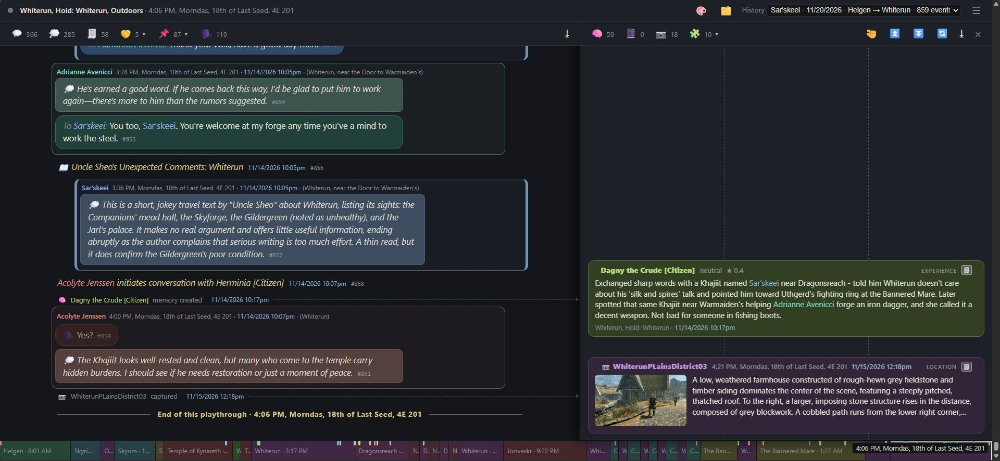
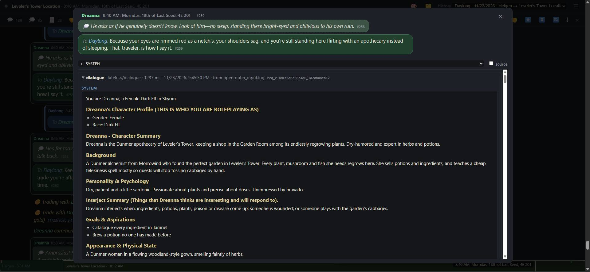

# SkyrimNet event view

A cleaner page for reading what SkyrimNet's NPCs say, think and remember.





- **Left column:** the conversation, one box per turn (NPC or yours) in the speaker's colour.
- **Right column:** memories, diaries, OmniSight screenshots and other mods' events (IntelEngine, PoliticalEngine…), in step with the conversation.
- **History:** the live game, any older playthrough, or any day of the conversation log.
- **Prompts:** click a line, or 🧾 on a memory, diary or OmniSight card, to see the LLM prompt that produced it.

It only reads: nothing here writes to the game, SkyrimNet or its files.

## Getting it

1. Install [Python 3](https://www.python.org/downloads/). On Windows, tick **Add python.exe to PATH** on the installer's first screen. Nothing else is needed.
2. On this repository's GitHub page, click **Code → Download ZIP** and unzip it anywhere (it doesn't go in your Skyrim or MO2 folders). Or `git clone` it.
3. Play with SkyrimNet at least once, so it has written its data, then follow *Running it* below. The helper finds your SkyrimNet folder by itself; if it doesn't, list the folder under `skyrimnet:` in `config.yaml`.

If double-clicking `sn-eventview.bat` says Python was not found, or opens the Microsoft Store, Python isn't installed or isn't on PATH: install it again with the PATH option ticked, then open a new window.

## Running it

Double-click `sn-eventview.bat`. It starts a small helper on <http://localhost:8791/> and opens the page in your browser. Close the window to stop it.

From a terminal: `python serve.py` (Python 3, standard library only). Options:

| Command | What it does |
|---|---|
| `python serve.py <SkyrimNet folder>` | Read only that SkyrimNet folder (default: every one it finds, see below) |
| `python serve.py --no-browser` | Don't open a browser tab |
| `python serve.py --check` | Self-test against the real folder |
| `python serve.py --types` | List every event type with counts, for `config.yaml` |

Opening `index.html` straight from disk also works for the live game, but without history, memories, older prompts or `config.yaml`. The page says so where those would be. `?host=http://…:8080` points it at another SkyrimNet server.

## The page

**Top bar:** where you are (follows your scrolling), 🎨 coloured names, 🌓 timeline by game time (space the timeline by game time instead of an even share per event, so a sleep or a long journey takes room; off at first), 🗂️ the context column, the **History** picker, and **☰**.

- Modlist (in ☰, shown when there is more than one): every SkyrimNet folder the helper finds when it starts (restart it after adding one): the folders listed under `skyrimnet:` in `config.yaml`, then every MO2 instance's overwrite folder (a `ModOrganizer.ini` up to two folders deep on any local drive, or a global instance in `%LOCALAPPDATA%\ModOrganizer`), then the game's own `Data` folder (Vortex, manual installs), then any `<drive>:\Modlists\*\overwrite` folder. Each is named after its MO2 instance, mod or game folder; folders that share a name all get their parent folder added, such as *ADT (Modlists)*. ● marks the one being played, or played last: the page starts there, and *Live* always reads it. Picking another modlist opens its newest playthrough. The address keeps the modlist and view (`#ml=…&view=…`), so a refresh or a bookmark opens them again.

- History: *Live (current save)*, then **playthroughs** (newest first, named after your character), then the **conversation log** by real day.
- A playthrough's events are cut back to the save point when you load an older save. The conversation log keeps every line ever said, but has no locations or game time.

**Chat column**

- Each turn, an NPC's or yours, is one box outlined in the speaker's colour (yours in the player blue, shifted to the right, with thick sides and a striped backing), its thoughts and lines together. The header shows name, game date and time, and the place within the cell. Inside the box:
  - 💭 thoughts: a paler bubble.
  - Spoken lines start with **To *listener*:**, with the listener's name in their own colour.
  - 🗣️ marks background chatter.
  - 🎮 marks the game's own dialogue, in a dashed outline with no fill: a line you picked in its dialogue menu, or an NPC's recorded reply. SkyrimNet didn't write these, so their 🧾 doesn't look for a matching reply; it lists the model requests made around them (reactions, actions they set off).
- Narration is in gold italics, with 📖 books and 💤 sleep.
- Actions get their own line behind their kind's icon. The 🤝 menu in the bar switches each kind (counts beside them), or all at once:
  🎬 custom actions, 🪙 trades and purchases, 💰 gold and debts, 🎁 items given and taken, 🗝️ looting, 🍖 consumed (food, drink, potions: "Jenassa consumed Ale"), 👊 brawls and fights, 🫳 pickpocketing, 🧭 followers (joining, leaving, waiting), 🪑 furniture, 🎯 actions a reply picked, and, off at first, ⚠️ failed actions (couldn't find, couldn't reach…) and 📊 relationship checks.
- 🎯 An action the model picked in an NPC's reply (`ACTION: drink_alcohol PARAMS: …`), under the line from that reply. SkyrimNet takes that part out of the line it saves, but the prompt logs keep the whole reply, so this needs serve.py or the live game, and only shows while those logs exist. It is what the NPC tried: SkyrimNet drops an action that isn't allowed at that moment, so it may not have happened. Made-up stubs (`speak`, `None`) and the game master's directions are left out.
- 💤 marks going to sleep and waking up.
- Your own lines are blue.
- A band with faint › chevrons in its own colour across its right two thirds, edged like your turns (thick sides), in the colour of the cell's block in the timeline, marks each change of cell: "📍 Arrived at **Whiterun** from Drunken Huntsman" (where you came from greyed, so a door and a jump across the map, such as `coc` or fast travel, read differently), with the rest of the location beside it, and under it the game date and time and *Here for* (the real time from the first line there to the last, gaps over 20 minutes left out; shown once it reaches a minute).
- The chat ends with **● Now** and the game time of the latest line (live), or *End of this playthrough* / *End of this day* in History.
- 📌 Markers such as *🧠 Hadvar memory created ┄┄┄*, *📔 Camilla Valerius diary written* and *📷 Embershard Mine captured* (and *🧩 IntelEngine · follower recruited* for 🧩 groups) sit after the line each card in the context column belongs to. Click one to bring its card into view.
- Bar: 💬 dialogue, 💭 thoughts and 🧾 narration toggles, the 🤝 actions menu, 📌 markers menu (all, or each kind on its own: 🧠 memories, 📔 diaries, 📷 OmniSight pictures, each 🧩 group; only kinds the view has are listed), 🗣️ background chatter, 🎮 the game's own dialogue, each with counts; ⏫ ⏬ previous and next place (scroll to where you arrived in a cell); ⤓ keep scrolling (follow new lines as they arrive).

**Context column** (right; 🗂️ next to History shows or hides it)

| Toggle | Cards |
|---|---|
| 🧠 | NPC memories: owner, emotion, importance, kind (background knowledge entries are left out; so is SkyrimNet's memory copy of a diary entry while 📔 cards are loaded) |
| 🧩 | other mods' events, taken out of the chat: a menu of the `config.yaml` column groups (IntelEngine, PoliticalEngine…) plus a group of its own for any event type the page has no line style for (`dragonsense_event` → *dragonsense*; give it a `column:` group to rename or recolour it). Lists only groups with events in this view ("None in this view" when there are none) |
| 📔 | NPC diary entries, rendered as markdown |
| 📷 | OmniSight screenshots with their descriptions (click the picture or the description to see both large, middle-click the picture for a new tab) |

- **Following you:** cards whose 📌 marker (or line) is still below the bottom of the chat are dimmed; every card whose marker you can see is lit (not with 🔄️ on, where position shows it). The outlined card is the newest one at or above the chat line under the bar, and ⤓ keeps it in view, gliding the column to each new one (it jumps when the new one is far away, as after picking another view).
- **🤏 Compact:** each OmniSight picture small with the first four lines of its description beside it, and the start of each diary (an OmniSight picture's popup still has the whole description). Off: whole descriptions and diaries.
- **🔄️ Line up:** each card sits beside the chat line it belongs to and the column scrolls with the chat (the mouse wheel over the column scrolls the chat). Where cards crowd, the column moves faster than the chat, but never more than 2.5 times as fast: it starts moving before a bunch of markers and catches up after it, so each card there sits a little ahead of or behind its marker instead of flying past. Over the last screen of the chat it runs a little ahead, so the last cards come fully into view as the chat reaches its end. Off: the column scrolls on its own and ⤓ applies.
- **⏫ ⏬ Previous / next card** (with 🔄️ on; greyed out otherwise): scrolls the chat to the previous or next visible card's 📌 marker, a third of the way down the chat, with the card lined up beside it and outlined for a moment. Press again while it glides to step on.
- Turning a card type off (🧠, 📔, 📷) also hides its 📌 markers in the chat.
- **Find a card's line:** clicking a card (its header or footer, for memories, diaries and pictures) lights up its 📌 marker (or its line) and the card. The chat scrolls only if the marker is off screen.
- **Names:** names inside the cards are coloured, as in the chat (🎨 in the top bar turns both off).

**Timeline** (bottom)

- One block per stay in a cell, as wide as its share of the events, or with 🌓 timeline by game time, its share of the time. There, an hour or more with nothing happening (sleeping, waiting, fast travel) is greyed out. Hover a block for its time span and real time.
- A wave over the blocks follows the sun, glowing like the sky at that hour (gold at noon, orange at sunrise and sunset, nothing at night): high at noon, flat at midnight. Spaced by event it bends with how busy each hour was; by game time it is an even wave. The conversation log has only real time, so it has no wave and is spaced by real time.
- The cursor shows the date and time of what you're reading. Coloured ticks mark memories.
- Click or drag to jump.

**Prompt popup:** click any line.

- A popup opens with the line at the top, as it reads in the chat, and below it the request that produced it, found by matching the reply text: model, tokens, time, then each message as rendered markdown, and at the end the event's JSON. × or Esc closes it.
- One reply often holds a thought and a line of dialogue (sometimes more). Once its request is found, the top of the popup shows every line of that speaker's box that came from the same reply, and they stay highlighted in the chat. When a speaker has several such pairs in a row, each pair has its own reply, so each line shows only its own pair.
- Consecutive messages from one role (the event history comes as many short user messages) share one label, such as *USER · 15 messages*, and one box, with a dashed line between messages.
- **source** (above the prompt) shows the exact text.
- The dropdown above the prompt lists the messages and headings. It follows your scrolling; pick one to jump there.
- 🧾 (after the kind, in a memory, diary or OmniSight card's top line) opens the card in the same popup, with the prompt that wrote it (found the same way) on the left, beside it. It is boxed in white when there is a prompt to show, and in grey with a ❌ over it when none can be found for that card: hover it for why, and clicking opens the popup without a prompt column. × or Esc closes the popup.
- In that popup, 🧾 (next to ×) shows or hides the prompt, or, greyed, says why there is none. Clicking a memory's text opens it as a chat line does, with its prompt shown below it. Opening a diary entry or OmniSight picture by clicking its text or picture starts with the prompt hidden.
- Prompts come from SkyrimNet's request log (since the game started) and its prompt log files on disk.

**When there's no prompt to show** (the popup says which case it is):

- **The line never had one, or its text isn't in a reply.** The page finds a line's prompt by looking for its text in a model's reply, so only text a model wrote can be matched: NPC dialogue and thoughts, game master and narrator lines, memories, diaries and OmniSight descriptions. Lines you typed, game events such as books, sleep and deaths, and actions (🤝, even when a model chose them) can't be. The popup says no request's reply contains the text and lists the requests made around that moment.
- **The prompt log has been deleted.** SkyrimNet keeps only its last few prompt log files (`openrouter_input*.log`), rotating them by size, so how far back prompts go depends on how much you've played since: often only the last day or so. Older lines say they're older than the oldest prompt log on disk. The model's replies (`openrouter_output*.log`) are kept longer, but without the prompt they can't be shown.
- **The page was opened from disk** (no `serve.py`): only SkyrimNet's request log is searched, which holds requests since the game was launched. Run `serve.py` to search the log files too.
- **A mod wrote the memory, not a model.** A memory tied to no chat event and held by no reply was put there by a mod's code, such as Immersive Diseases' illness memories or PoliticalEngine's letter notes. Its 🧾 is greyed, and the tooltip says so and lists the memory's tags.

Narrative Engine plot memories ("Nenya asked me to keep watch on Narri…", "I sent Helvard to…") are filled in by that mod from its director's plan, so their sentence is in no reply either. Their 🧾 opens that plan instead: the Narrative Engine request answered in the 15 seconds before the memory that names someone the memory names.

**☰ menu:**
- modlist
- Show event ids: event ids on lines, request ids on prompts
- Show empty responses: dialogue lines SkyrimNet stored with no text ("Lucia said nothing")
- Show real-world time: the real date and time on every chat line, marker and card, beside the game time (on at first)
- Show line bubbles: a filled, rounded box around each spoken line (on at first; off: the text alone, inside its speaker's box, which then takes the line bubbles' fill while its 💭 thoughts go dark)
- Text size − / +: make all the page's text smaller or larger, 70% to 160%
- Sky wave − / +: how strongly the timeline's day and night wave shows, 0% (hidden) to 100%

Toggles are remembered by the browser.

## config.yaml

Reload the page after editing (`serve.py` tells the browser to check for a newer page and config.yaml on every load; only OmniSight pictures are cached). Only read when the page comes from `serve.py`.

```yaml
skyrimnet:                  # SkyrimNet folders the helper doesn't find by itself (restart the helper)
  - 'E:\MO2\overwrite\SKSE\Plugins\SkyrimNet'
lan: no                     # yes = other devices on your network or Tailscale can open http://<this PC's IP>:8791/ (restart the helper)

hide:                       # lines to leave out: regular expressions, case-insensitive
  - 'continues the conversation\.?$'

memories: yes               # no = no 🧠 cards, markers or toggle
diary: yes                  # no = no 📔 cards, markers or toggle
omnisight: yes              # no = no 📷 cards, markers or toggle

column:                     # event groups shown as cards in the right column instead of the chat
  - label: IntelEngine      # toggle text (an emoji works)
    hue: 190                # card colour, 0-360
    types: '^(intel_.*|follower_recruited)$'   # event types (see serve.py --types)
  - label: PoliticalEngine
    hue: 42
    types: '^political_'
    # shown: no            # the toggle starts off
```

Keep patterns in single quotes. The reader understands this subset of YAML: `key: value`, lists of values and lists of maps, with `# comments` on their own lines or after a value.

## Where the data comes from

All paths are inside the picked SkyrimNet folder (for MO2, `overwrite/SKSE/Plugins/SkyrimNet`).

| Source | Used for |
|---|---|
| SkyrimNet's web API, `http://127.0.0.1:8080` | live events, the request log since launch |
| `data/SkyrimNet-*.db` (opened read-only) | playthroughs: events, memories, diary entries, names, OmniSight records |
| `logs/conversation_log*.log`, `logs/_archive/` | history by real day |
| `logs/openrouter_input*.log`, `logs/openrouter_output*.log` | prompts for older lines |
| `screenshots/omnisight/*.png` | OmniSight pictures |

Things SkyrimNet doesn't keep, so the page can't show them:

- **Spoken audio:** TTS plays from memory and is never saved.
- **Older prompts:** SkyrimNet keeps only its last few prompt log files (see *When there's no prompt to show*).
- **Older OmniSight pictures:** OmniSight keeps one picture per subject and replaces it when it retakes it, so an older playthrough can show a newer picture.

## Files

| File | |
|---|---|
| `index.html` | the page: markup, style and script in one file, built with DOM nodes only (no `innerHTML`) |
| `serve.py` | the read-only helper: static files plus `/local/*` JSON routes, bound to 127.0.0.1 only (all addresses with `lan: yes`); answers only requests addressed to localhost, or to an IP address with `lan: yes` |
| `sn-eventview.bat` | double-click launcher |
| `config.yaml` | LAN access, hide list and right-column groups |
| `LICENSE` | MIT |

With `lan: yes`, a page opened from another device reaches SkyrimNet through the helper (`/sn/…`, only the three read-only calls the page makes), since SkyrimNet itself answers only on this PC. Anyone who can reach this PC can then read your dialogue, memories and diaries.
